<!-- animated contribution graph: real data, boxes reveal cell by cell
     (regenerated daily by .github/workflows/update-profile-art.yml) -->

<h3><code>pritam@github ~ $ ./contributions.sh</code></h3>

 
 

<!-- ascii developer art (left) + streak/numbers card (right). both svgs are
     840x880 so equal widths give equal heights.
     developer: python scripts/make_ascii_svg.py
     stats:     python scripts/render_stats_svg.py (same daily workflow) -->

<h3><code>pritam@github ~ $ whoami</code></h3>

<table>
<tr>
<td valign="top"></td>
<td valign="top"></td>
</tr>
</table>

 
 

<h3><code>pritam@github ~ $ ./links.sh</code></h3>

<b>Full-Stack Developer · AI/ML Builder · CS Student @ SRM University–AP</b>

Undergrad CS student who spends most of his time building things — full-stack apps,
AI-powered tools, and the occasional Web3 experiment. Interested in agentic AI,
scalable backend systems, and making developer tooling that doesn't get in the way.
Currently exploring LLMs, intelligent agents, and blockchain-based products.

 

**Tech I work with:**

 

